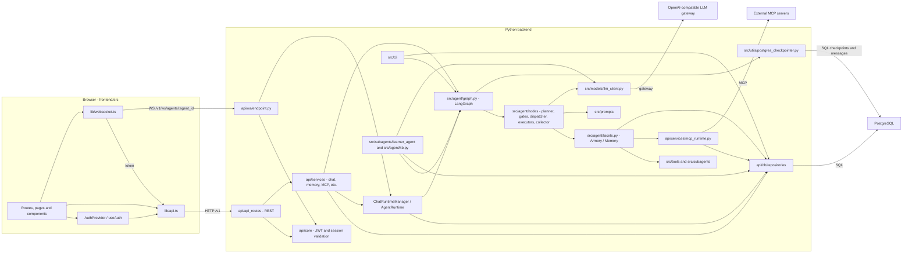

# Component and dependency diagram

Arrows point from a caller to the component it uses. Solid arrows are in-process dependencies; labels `HTTP`, `WS`, `SQL` and `gateway` mark external calls. This is the current high-level component map, not the individual LangGraph node transition diagram.

**Reading the execution path:** the WebSocket endpoint validates the user/agent, then the runtime manager starts `AgentRuntime`. It runs the compiled graph; the planner uses prompts and the shared LLM client, and the graph routes validated actions through Armory/child/human executors, result collection and the output security gate. Checkpoints and execution events persist to PostgreSQL. The CLI enters the same graph without the HTTP/WebSocket transport. The learner runs separately and consumes saved trajectory data.

**Cross-package exception:** the graph and API do not form a strict dependency pyramid. Runtime/learner code uses API repositories and MCP services, and repository policy code imports `src.agent.policy_schema`. See [cross-layer dependencies](layer-dependencies.md) for the permitted and prohibited boundaries.
